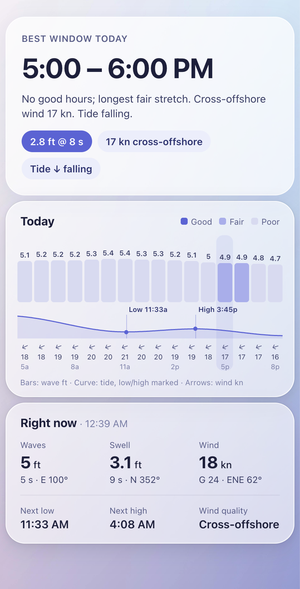
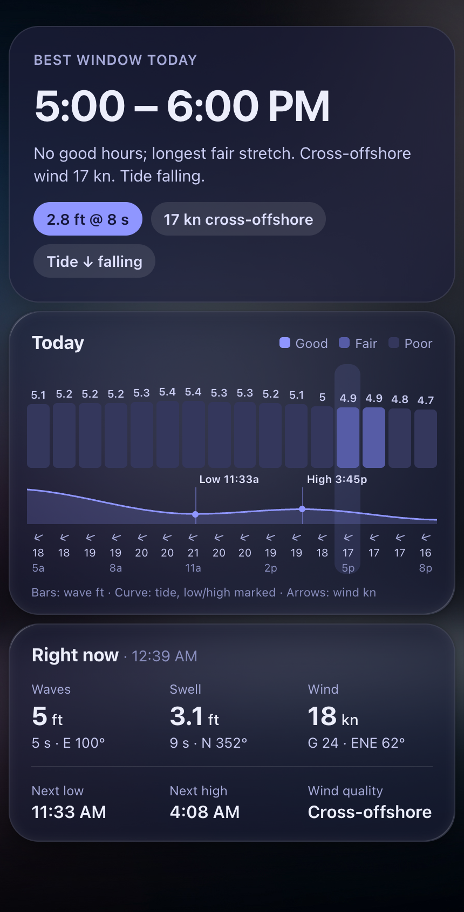

# Surf Forecast for Home Assistant

A Home Assistant integration that turns [Stormglass](https://stormglass.io)
marine data into a surf forecast for a specific break: wave height, swell
period, tide, wind relative to the shore, and a single 0–10 rating that says
whether it is worth going.

Built around one hard constraint: **the free Stormglass plan allows 10 API
requests per day.** Most of the design below exists to stay under that.

## Examples

 

A dashboard built only from this integration's entities, for Kewalo Basin in
Honolulu. To build the same one, see [Example dashboard](#example-dashboard).
The background is the [Frosted Glass](https://github.com/wessamlauf/homeassistant-frosted-glass-themes)
theme; the cards bring their own colours and work on any theme.


## What you get

Each spot you add becomes a device with these entities.

**The judgement**

| Entity | What it tells you |
| --- | --- |
| `Surf rating` | 0–10, with the component scores as attributes |
| `Surf conditions` | Flat / Poor / Fair / Good / Very good / Epic |
| `Wind direction relative to shore` | Glassy, Offshore, Cross-offshore, Cross-shore, Cross-onshore, Onshore |
| `Best window today` | Timestamp of the best-rated remaining daylight hour |
| `Good surf` | On when the rating clears your threshold |
| `Clean wind` | On when the wind is glassy or has an offshore component |

**The numbers** — wave height, period and direction; swell and secondary
swell; wind wave; wind speed, gust and direction; water and air temperature;
current speed and direction.

**Tide and sky** — tide state, next high tide, next low tide, sunrise, sunset,
moon phase and illumination.

**Diagnostics** — API requests remaining, last forecast fetch, and a quota
exhausted problem sensor.

Secondary swell, wind wave, current and moon entities are disabled by default;
enable them per entity if you want them.

## How the rating works

Three questions, asked in the order a surfer asks them.

1. **Is there enough swell?** Wave height is scored against the ideal band you
   configure (1.0–2.5 m by default). Below 0.3 m scores zero; well above the
   band decays toward a floor rather than to zero, because oversized surf is
   still surf for somebody. Only swell that can reach the break counts:
   components arriving from more than 100 degrees off the shore direction
   would have to cross land, so they are left out. On a lee-side break this
   matters a lot — at a south-facing Hawaiian spot, trade-wind chop from the
   east-northeast can double the open-water wave height without ever
   touching the beach. The height actually used is on the rating as
   `surf_height_m`.
2. **Does it have power?** Swell period from 5 s (wind slop) to 15 s
   (groundswell).
3. **Is the wind wrecking it?** Calm air is ideal regardless of direction. As
   the wind builds, direction matters more, scored from the angle between the
   wind and a dead-offshore wind. The falloff is steepest through
   cross-offshore and cross-shore, which is where surf-forecast.com's own
   ratings collapse once the wind gets up: across 207 of their forecast hours,
   a cross-offshore break loses half its rating when the wind passes 5 m/s
   while a dead-offshore one loses none. Only a gale is penalised from
   offshore, because it stops waves breaking cleanly.

Size gates the result, so a glassy long-period forecast on a flat ocean still
rates zero:

```
quality = 0.40 * period_score + 0.60 * wind_score
rating  = 10 * height_score * (0.15 + 0.85 * quality)
```

## Which way does the beach face?

Shore direction is the compass bearing the beach looks out to sea: a
west-facing California beach is `270`, a south-facing one is `180`. An offshore
wind then arrives from the opposite bearing. **Get this wrong and the wind
scoring inverts**, so setup offers three ways to get it right.

**1. Pick a compass direction.** Setup asks which way the beach looks out to
sea and offers the sixteen compass points: a south-facing break is *South*, a
west-facing one is *West*. That is how people describe a spot out loud, and it
is precise enough — 22.5 degree steps mean at most 11 degrees of error, which
costs about a third of a rating point. The mistake that actually matters is
being 80 degrees out, which a dropdown makes hard to do.

**2. A coastline estimate** prefills that dropdown. OSM draws
`natural=coastline` with land on the left and water on the right, so a
segment's seaward normal is its bearing plus 90 degrees. Taking the nearest
segment is unreliable near harbours and jetties — exactly where surf spots are
— so this takes a length-weighted circular mean of nearby segments, ignores
anything under 50 m, and reports how well they agreed. If they do not agree, no
estimate is offered rather than a confident wrong one.

**3. Enter an exact bearing** instead, if you already know it.

### The integration checks your answer

Waves cannot cross land to reach a break. So if the forecast shows swell
persistently arriving from behind the beach, the shore direction must be wrong
— and the integration says so, with a repair notice suggesting a better value.
This runs on data already fetched, so it costs no API quota.

You do not need to be precise: the rating moves by roughly 0.3 per 10 degrees,
so within about 15 degrees is plenty. Being 80 degrees out is what flips
offshore to onshore.

## Staying inside 10 requests a day

Each endpoint call costs exactly one request, whatever you ask it for. So:

- **One request buys the whole forecast.** All 20 marine parameters, for every
  hour of the horizon, come back in a single weather call.
- **Tide and astronomy are refetched rarely.** Astronomical tide and sun/moon
  times are deterministic, so a 10-day tide fetch stays valid for 10 days. They
  are renewed only when they age out (12 hours) or their horizon runs short.
- **Restarts are free.** Raw payloads are persisted, so restarting Home
  Assistant or reloading the entry serves from cache instead of the network.
- **Current conditions still track the clock.** Derived values are recomputed
  from the cache every hour at no cost, so "now" is right even though the
  network fetch happens every 6 hours.
- **A reserve is held back** so a manual reload never hits a hard stop.

At the default 6-hour interval that is roughly **6 requests per day**.

If the allowance does run out, the integration keeps publishing the cached
forecast for as long as it still covers the current time, rather than going
blank. Once the cache is genuinely exhausted the entities go unavailable
instead of showing stale nonsense.

Note that **validating your API key during setup spends one request.**

## Installation

### HACS (custom repository)

1. HACS → Integrations → ⋮ → Custom repositories
2. Add `https://github.com/jcconnell/ha-surf-forecast`, category *Integration*
3. Install, then restart Home Assistant

### Manual

Copy `custom_components/surf_forecast` into your `config/custom_components/`
directory and restart Home Assistant.

## Setup

1. Get a free API key at
   [dashboard.stormglass.io](https://dashboard.stormglass.io/register).
2. Settings → Devices & Services → **Add Integration** → *Surf Forecast*.
3. Enter a spot name, the API key, and the break's location. The next screen
   asks which way the beach faces — see above.

Add the integration again for each additional spot. Note that every extra spot
multiplies your request usage, which the free plan will not stretch far.

### Options

| Option | Default | Notes |
| --- | --- | --- |
| Hours between forecast refreshes | 6 | 6 h ≈ 6 requests/day |
| Days of forecast to request | 5 | Costs nothing extra |
| Shore direction | 270° | Bearing the beach faces out to sea |
| Smallest / largest good wave height | 1.0 / 2.5 m | Your ideal band |
| Rating that counts as good surf | 5.0 | Drives the `Good surf` sensor |
| Tide datum | MSL | `LAT`, `MLLW`, `MLW`, `MSL`, `MHW`, `MHHW`, `HAT` |
| Fetch tide data | on | Turn off to save a request |
| Fetch sunrise, sunset and moon data | on | Turn off to save a request |

### Units

Wave heights are reported in metres and shown in feet on the US unit system;
wind is reported in m/s and shown in mph. Every one of those can be overridden
per entity in Home Assistant — open the entity, then its settings, and pick a
unit. Wind speed and gust accept **knots** (`kn`), which is usually what you
want for a marine forecast, along with km/h, ft/s and Beaufort.

## Example automation

```yaml
automation:
  - alias: "Dawn patrol callout"
    triggers:
      - trigger: time
        at: "05:45:00"
    conditions:
      - condition: numeric_state
        entity_id: sensor.home_break_surf_rating
        above: 6
    actions:
      - action: notify.mobile_app_phone
        data:
          title: "Surf is on"
          message: >-
            {{ states('sensor.home_break_surf_conditions') }} —
            {{ states('sensor.home_break_wave_height') }}
            {{ state_attr('sensor.home_break_wave_height','unit_of_measurement') }}
            at {{ states('sensor.home_break_swell_period') }}s,
            {{ states('sensor.home_break_wind_direction_relative_to_shore') | lower }}.
            Best window
            {{ as_timestamp(states('sensor.home_break_best_window_today'))
               | timestamp_custom('%-I:%M %p') }}.
```

## Hourly attributes for dashboards

Two sensors carry the detail a dashboard needs to draw a day, built from data
already fetched, so they cost no extra requests. Both start at local midnight,
so the hours already gone today are there too, and both are excluded from the
recorder database.

The `Surf rating` sensor's `forecast` attribute lists every hour from local
midnight to 24 hours from now, rated:

| Key | Unit | Notes |
| --- | --- | --- |
| `time` | ISO 8601, UTC | Start of the hour |
| `rating` | 0–10 | |
| `conditions` | | Flat / Poor / Fair / Good / Very good / Epic |
| `wave_height` | m | Combined open-water wave height |
| `surf_height` | m | Swell that can reach the break, as rated |
| `swell_period` | s | Period of the swell that reaches the break |
| `wind_speed` | m/s | |
| `wind_relation` | | Glassy, Offshore, … Onshore |
| `wave_period` | s | Combined open-water wave period |
| `wave_direction` | ° | Direction the waves come from |
| `swell_height` | m | Primary swell, unfiltered |
| `swell_direction` | ° | Direction the primary swell comes from |
| `wind_direction` | ° | Direction the wind comes from |
| `gust` | m/s | |
| `sea_level` | m | Hourly sea level relative to mean sea level, for a tide curve |

A value Stormglass did not supply is `null`; the key is always present.

The `Tide` sensor's `tides` attribute lists the high and low extremes as
`{time, type, height}`, with `type` either `high` or `low` and `height` in metres
on the configured tide datum. It starts with the last extreme before local
midnight, so a curve can be drawn from 12 am, and runs to 48 hours from now.
Tides are fetched from 12 hours before local midnight to make that possible; it
is still one request.

## Example dashboard

The screenshots at the top are three [button-card](https://github.com/custom-cards/button-card)
cards reading one template sensor. Everything they show comes from the
attributes above, so the dashboard costs no extra requests. The files are in
[`examples/dashboard`](examples/dashboard).

| File | What it is |
| --- | --- |
| [`surf_package.yaml`](examples/dashboard/surf_package.yaml) | A [package](https://www.home-assistant.io/docs/configuration/packages/) that builds `sensor.surf_hourly`: today's hours from 5 AM to 8 PM, the best daylight window, and the tide extremes, in feet and knots |
| [`surf_view.yaml`](examples/dashboard/surf_view.yaml) | The `surf_card` button-card template and a view with the three cards |

The package reshapes the forecast into one entity. It is trigger-based YAML
rather than a UI template helper because it keeps list attributes.

1. Install **button-card** from HACS (Frontend).
2. Copy `surf_package.yaml` into your packages folder. If you don't have one
   yet, add this to `configuration.yaml`:
   ```yaml
   homeassistant:
     packages: !include_dir_named packages
   ```
3. In the package, replace every `kewalos` with your spot's entity prefix: the
   spot name you entered at setup, lower-cased with spaces as underscores
   (`sensor.home_break_surf_rating` → `home_break`).
4. The cards label sizes in feet and wind in knots. Forecast hours are
   converted in the package, but the **Right now** values are read as Home
   Assistant displays them, so set the wave height, swell height, wind speed
   and wind gust entities to `ft` and `kn` (see [Units](#units)).
5. Restart Home Assistant, or reload **Template entities** from the **YAML**
   tab of **Tools** (**Developer Tools** before 2026.8). Check that
   `sensor.surf_hourly` has an `hours` attribute.
6. Settings → Dashboards → **Add dashboard** → *New dashboard from scratch*.
   Open it, then pencil → ⋮ → **Raw configuration editor**, and paste
   `surf_view.yaml` in place of what is there.

On an existing dashboard, put `surf_card` under that dashboard's
`button_card_templates:` and add the view to its `views:` instead of replacing
the whole configuration.

### Updating the screenshots

[`scripts/screenshot.py`](scripts/screenshot.py) renders a dashboard view in
headless Chrome at phone width, in light and dark mode, and writes
`docs/images/dashboard-light.png` and `dashboard-dark.png`. It signs in with a
long-lived access token (your profile → Security → Long-lived access tokens):

```bash
pip install playwright
export HASS_SERVER=http://homeassistant.local:8123
export HASS_TOKEN=<long-lived access token>
python scripts/screenshot.py --view lovelace/surf --out docs/images
```

`--view` is the dashboard path as it appears in the browser address bar. The
page uses the token owner's profile theme, with dark mode switched per shot. The
script uses your installed Google Chrome; pass `--channel chromium` after
`playwright install chromium` to use Playwright's own build. The screenshots
show whatever the forecast is at the time, so take them on a day with
something worth showing.

## Tests

Two suites. The scoring and parsing logic has no Home Assistant dependency and
runs on its own:

```bash
pip install pytest
python -m pytest tests -q
```

The integration tests drive real Home Assistant with mocked HTTP:

```bash
pip install pytest-homeassistant-custom-component
python -m pytest tests tests_ha -q
```

## Credits

Weather, tide and astronomy data from [Stormglass.io](https://stormglass.io).
Not affiliated with or endorsed by Stormglass.
